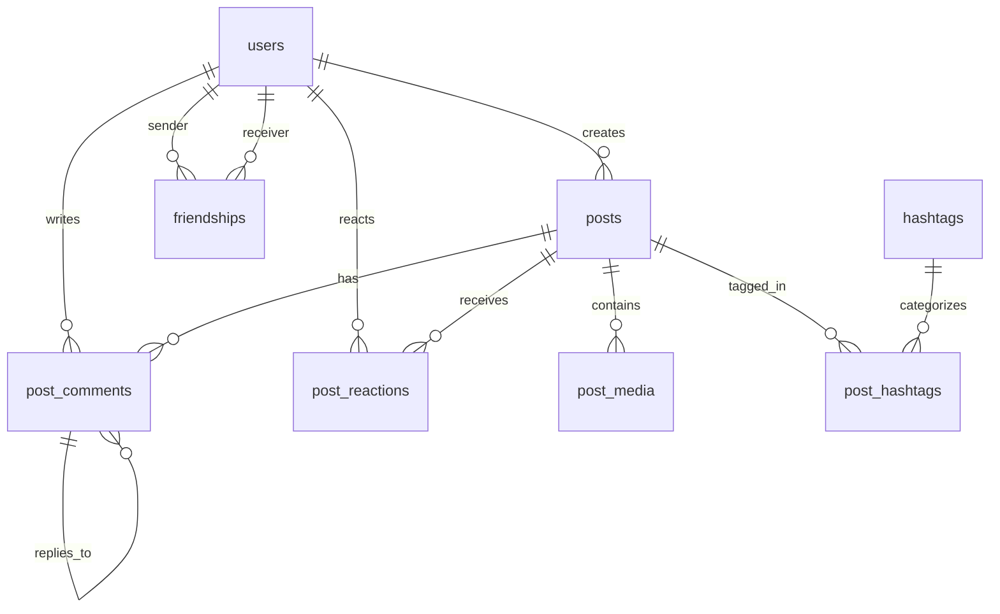

# DATABASE_SCHEMA.md - Thiết Kế Cơ Sở Dữ Liệu Connexa (Module: Posts, Interactions, Friends & Hashtags)

Tài liệu từ điển dữ liệu (Data Dictionary), quy ước đặt tên và cấu trúc bảng cho cơ sở dữ liệu PostgreSQL của hệ thống Connexa.

---

## 1. Quy ước đặt tên & Chuẩn dữ liệu (Conventions)

- **Tên bảng**: Danh từ số nhiều, chữ thường, dạng `snake_case` (ví dụ: `users`, `posts`, `post_media`, `hashtags`, `post_hashtags`, `friendships`).
- **Khóa chính (PK)**: Luôn là `id UUID PRIMARY KEY DEFAULT gen_random_uuid()`.
- **Khóa ngoại (FK)**: Dạng `<tên_thực_thể_số_ít>_id` kiểu `UUID`. Bắt buộc cấu hình `ON DELETE CASCADE`.
- **Thời gian (Timestamp)**: Sử dụng kiểu `TIMESTAMP` (Without Time Zone), mặc định `DEFAULT CURRENT_TIMESTAMP`.
- **Cờ logic (Booleans)**: Bắt đầu bằng tiền tố `is_` (ví dụ: `is_deleted`, `is_edited`), kiểu `BOOLEAN DEFAULT FALSE`.
- **Chuỗi văn bản ngắn**: Dùng `VARCHAR(length)` có giới hạn.
- **Văn bản dài**: Dùng `TEXT`.

---

## 2. Sơ đồ ERD (Entity Relationship Diagram)

---

## 3. Cấu trúc Bảng Chi Tiết (Active Schema)

### 3.1. Bảng `users` (Bảng người dùng)
> **Lưu ý**: Khớp 100% với Entity `User.java` hiện có để đảm bảo hệ thống Auth & Chat không bị ảnh hưởng.

| Tên cột | Kiểu dữ liệu | Ràng buộc | Mô tả |
| :--- | :--- | :--- | :--- |
| `id` | `UUID` | `PRIMARY KEY, DEFAULT gen_random_uuid()` | Khóa chính |
| `username` | `VARCHAR(255)` | `NOT NULL, UNIQUE` | Tên tài khoản |
| `email` | `VARCHAR(255)` | `NOT NULL, UNIQUE` | Email đăng nhập |
| `password` | `VARCHAR(255)` | `NOT NULL` | Mật khẩu (đã mã hóa) |
| `role` | `VARCHAR(50)` | `NOT NULL, DEFAULT 'USER'` | Phân quyền: `USER`, `ADMIN` |
| `avatar_url` | `TEXT` | `NULL` | Ảnh đại diện tác giả |
| `is_online` | `BOOLEAN` | `NOT NULL, DEFAULT FALSE` | Trạng thái online |
| `last_seen` | `TIMESTAMP` | `NULL` | Thời điểm online gần nhất |
| `created_at` | `TIMESTAMP` | `NOT NULL, DEFAULT CURRENT_TIMESTAMP` | Thời điểm tạo tài khoản |
| `is_locked` | `BOOLEAN` | `NOT NULL, DEFAULT FALSE` | Trạng thái tài khoản bị khóa (Mức 1) |
| `lock_until` | `TIMESTAMP` | `NULL` | Thời điểm hết hạn khóa tạm thời (NULL nếu khóa vĩnh viễn/chưa khóa) |
| `lock_reason`| `TEXT` | `NULL` | Lý do khóa tài khoản |

---

### 3.2. Bảng `posts` (Bài viết)
Lưu trữ thông tin cốt lõi của bài viết do người dùng đăng tải.

| Tên cột | Kiểu dữ liệu | Ràng buộc | Mô tả |
| :--- | :--- | :--- | :--- |
| `id` | `UUID` | `PRIMARY KEY, DEFAULT gen_random_uuid()` | Khóa chính duy nhất |
| `user_id` | `UUID` | `NOT NULL, REFERENCES users(id) ON DELETE CASCADE` | ID tác giả bài viết |
| `content` | `TEXT` | `NOT NULL` | Nội dung văn bản bài viết |
| `privacy` | `VARCHAR(20)` | `NOT NULL, DEFAULT 'PUBLIC'` | Mức quyền: `PUBLIC`, `FRIENDS_ONLY`, `PRIVATE` |
| `like_count` | `INTEGER` | `NOT NULL, DEFAULT 0` | Số lượt like/reaction |
| `comment_count`| `INTEGER` | `NOT NULL, DEFAULT 0` | Số bình luận |
| `is_pinned` | `BOOLEAN` | `NOT NULL, DEFAULT FALSE` | Đánh dấu bài viết được Admin ghim lên đầu Feed |
| `is_edited` | `BOOLEAN` | `NOT NULL, DEFAULT FALSE` | Đánh dấu bài viết đã chỉnh sửa |
| `is_deleted` | `BOOLEAN` | `NOT NULL, DEFAULT FALSE` | Cờ xóa mềm (Soft Delete) |
| `created_at` | `TIMESTAMP` | `NOT NULL, DEFAULT CURRENT_TIMESTAMP` | Thời điểm đăng bài |
| `updated_at` | `TIMESTAMP` | `NOT NULL, DEFAULT CURRENT_TIMESTAMP` | Thời điểm cập nhật gần nhất |

**Chỉ mục (Indexes):**
- `idx_posts_user_id`: Tăng tốc truy vấn trang cá nhân (Profile timeline).
- `idx_posts_feed`: Composite Index trên `(is_deleted, privacy, created_at DESC)` để tối ưu câu truy vấn danh sách bài viết.
- `idx_posts_active_created_id`: Composite Index trên `(is_deleted, created_at DESC, id DESC)` tối ưu phân trang và sắp xếp bài viết ổn định (phục vụ Newsfeed và Search Post).

---

### 3.3. Bảng `post_media` (Tệp đính kèm bài viết)
Lưu trữ danh sách hình ảnh/video đính kèm (URL lưu trên Cloudinary).

| Tên cột | Kiểu dữ liệu | Ràng buộc | Mô tả |
| :--- | :--- | :--- | :--- |
| `id` | `UUID` | `PRIMARY KEY, DEFAULT gen_random_uuid()` | Khóa chính media |
| `post_id` | `UUID` | `NOT NULL, REFERENCES posts(id) ON DELETE CASCADE` | Thuộc bài viết nào |
| `media_url` | `TEXT` | `NOT NULL` | URL ảnh/video từ Cloudinary |
| `media_type` | `VARCHAR(20)` | `NOT NULL, DEFAULT 'IMAGE'` | Phân loại: `'IMAGE'`, `'VIDEO'` |
| `display_order` | `INTEGER` | `NOT NULL, DEFAULT 0` | Thứ tự hiển thị ảnh |
| `created_at` | `TIMESTAMP` | `NOT NULL, DEFAULT CURRENT_TIMESTAMP` | Thời điểm tải lên |

**Chỉ mục (Indexes):**
- `idx_post_media_post_id`: Tối ưu việc tải danh sách media theo `post_id` (hỗ trợ Batch Loading).

---

### 3.4. Bảng `hashtags` (Danh mục thẻ bắt đầu bằng #)
Lưu trữ danh mục hashtag được trích xuất từ bài viết, theo dõi số lượng bài viết gắn tag.

| Tên cột | Kiểu dữ liệu | Ràng buộc | Mô tả |
| :--- | :--- | :--- | :--- |
| `id` | `UUID` | `PRIMARY KEY, DEFAULT gen_random_uuid()` | Khóa chính |
| `name` | `VARCHAR(100)` | `NOT NULL, UNIQUE` | Tên hashtag chuẩn hóa (luôn lưu lowercase, không dấu #) |
| `usage_count` | `INTEGER` | `NOT NULL, DEFAULT 0` | Số lượng bài viết đang gắn hashtag này |
| `created_at` | `TIMESTAMP` | `NOT NULL, DEFAULT CURRENT_TIMESTAMP` | Thời điểm tạo hashtag |
| `updated_at` | `TIMESTAMP` | `NOT NULL, DEFAULT CURRENT_TIMESTAMP` | Thời điểm cập nhật số lượng sử dụng |

**Chỉ mục (Indexes):**
- `uq_hashtags_name`: Ràng buộc Unique trên `name`.
- `idx_hashtags_name`: B-Tree index trên `name` phục vụ tìm kiếm chính xác và gợi ý tự động hoàn thành (`LIKE prefix%`).
- `idx_hashtags_usage_count`: Index sắp xếp `(usage_count DESC)` phục vụ lấy danh sách Top Trending Hashtags.

---

### 3.5. Bảng `post_hashtags` (Bảng liên kết Bài viết - Hashtag)
Bảng trung gian quản lý quan hệ Nhiều - Nhiều (N-N) giữa `posts` và `hashtags`.

| Tên cột | Kiểu dữ liệu | Ràng buộc | Mô tả |
| :--- | :--- | :--- | :--- |
| `id` | `UUID` | `PRIMARY KEY, DEFAULT gen_random_uuid()` | Khóa chính |
| `post_id` | `UUID` | `NOT NULL, REFERENCES posts(id) ON DELETE CASCADE` | ID bài viết |
| `hashtag_id` | `UUID` | `NOT NULL, REFERENCES hashtags(id) ON DELETE CASCADE` | ID hashtag |
| `created_at` | `TIMESTAMP` | `NOT NULL, DEFAULT CURRENT_TIMESTAMP` | Thời điểm liên kết |

**Chỉ mục (Indexes):**
- `uq_post_hashtag`: Ràng buộc Unique cặp `(post_id, hashtag_id)` (chống gắn trùng một hashtag nhiều lần trên một bài viết).
- `idx_post_hashtags_post_id`: Tối ưu truy vấn batch nạp hashtags theo danh sách `postIds`.
- `idx_post_hashtags_hashtag_id`: Tối ưu đếm số bài viết theo hashtag.
- `idx_post_hashtags_hashtag_post`: Composite Index trên `(hashtag_id, post_id)` hỗ trợ Index-Only Scan khi tìm bài viết theo hashtag.

---

### 3.6. Bảng `friendships` (Quan hệ bạn bè)
Lưu trữ trạng thái kết bạn giữa hai người dùng (phục vụ lọc quyền riêng tư `FRIENDS_ONLY` cho Newsfeed và Search Post).

| Tên cột | Kiểu dữ liệu | Ràng buộc | Mô tả |
| :--- | :--- | :--- | :--- |
| `id` | `UUID` | `PRIMARY KEY, DEFAULT gen_random_uuid()` | Khóa chính |
| `sender_id` | `UUID` | `NOT NULL, REFERENCES users(id) ON DELETE CASCADE` | Người gửi lời mời kết bạn |
| `receiver_id` | `UUID` | `NOT NULL, REFERENCES users(id) ON DELETE CASCADE` | Người nhận lời mời kết bạn |
| `status` | `VARCHAR(50)` | `NOT NULL` | Trạng thái: `PENDING`, `ACCEPTED`, `REJECTED`, `BLOCKED` |
| `created_at` | `TIMESTAMP` | `NOT NULL, DEFAULT CURRENT_TIMESTAMP` | Thời điểm gửi lời mời |
| `updated_at` | `TIMESTAMP` | `NOT NULL, DEFAULT CURRENT_TIMESTAMP` | Thời điểm cập nhật trạng thái |

**Chỉ mục (Indexes):**
- `uq_friendship_sender_receiver`: Ràng buộc Unique cặp `(sender_id, receiver_id)`.
- `idx_friendships_sender`: Tối ưu tìm kiếm theo `sender_id`.
- `idx_friendships_receiver`: Tối ưu tìm kiếm theo `receiver_id`.
- `idx_friendships_sender_status_receiver`: Composite Index trên `(sender_id, status, receiver_id)` tối ưu câu truy vấn `EXISTS` kiểm tra bạn bè chiều gửi.
- `idx_friendships_receiver_status_sender`: Composite Index trên `(receiver_id, status, sender_id)` tối ưu câu truy vấn `EXISTS` kiểm tra bạn bè chiều nhận.

---

### 3.7. Bảng `post_comments` (Bình luận bài viết)
Lưu trữ bình luận và trả lời bình luận (hỗ trợ phân cấp cha - con 1 cấp).

| Tên cột | Kiểu dữ liệu | Ràng buộc | Mô tả |
| :--- | :--- | :--- | :--- |
| `id` | `UUID` | `PRIMARY KEY, DEFAULT gen_random_uuid()` | Khóa chính bình luận |
| `post_id` | `UUID` | `NOT NULL, REFERENCES posts(id) ON DELETE CASCADE` | ID bài viết được bình luận |
| `user_id` | `UUID` | `NOT NULL, REFERENCES users(id) ON DELETE CASCADE` | Tác giả bình luận |
| `parent_id` | `UUID` | `NULL, REFERENCES post_comments(id) ON DELETE CASCADE` | ID bình luận cha (nếu là bình luận phản hồi) |
| `content` | `TEXT` | `NOT NULL` | Nội dung bình luận |
| `is_deleted` | `BOOLEAN` | `NOT NULL, DEFAULT FALSE` | Cờ xóa mềm |
| `created_at` | `TIMESTAMP` | `NOT NULL, DEFAULT CURRENT_TIMESTAMP` | Thời điểm bình luận |
| `updated_at` | `TIMESTAMP` | `NULL` | Thời điểm chỉnh sửa |

---

### 3.8. Bảng `post_reactions` (Biểu cảm bài viết)
Lưu trữ các lượt tương tác cảm xúc (Like, Love, Haha, Wow, Sad, Angry) trên bài viết.

| Tên cột | Kiểu dữ liệu | Ràng buộc | Mô tả |
| :--- | :--- | :--- | :--- |
| `id` | `UUID` | `PRIMARY KEY, DEFAULT gen_random_uuid()` | Khóa chính |
| `post_id` | `UUID` | `NOT NULL, REFERENCES posts(id) ON DELETE CASCADE` | ID bài viết |
| `user_id` | `UUID` | `NOT NULL, REFERENCES users(id) ON DELETE CASCADE` | Người thả biểu cảm |
| `type` | `VARCHAR(20)` | `NOT NULL` | Loại reaction: `LIKE`, `LOVE`, `HAHA`, `WOW`, `SAD`, `ANGRY` |
| `created_at` | `TIMESTAMP` | `NOT NULL, DEFAULT CURRENT_TIMESTAMP` | Thời điểm tương tác |

**Ràng buộc & Chỉ mục:**
- `uq_post_reactions_post_user`: Ràng buộc Unique cặp `(post_id, user_id)` (mỗi người dùng chỉ có 1 biểu cảm tại 1 thời điểm trên mỗi bài viết).
